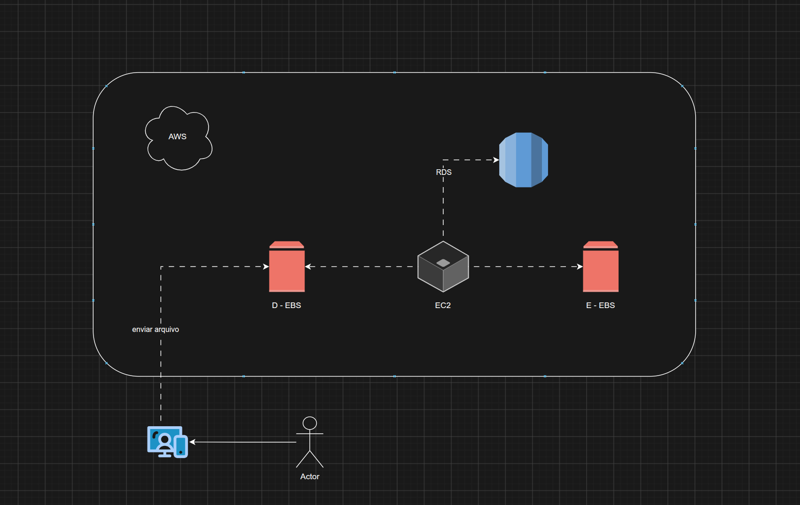
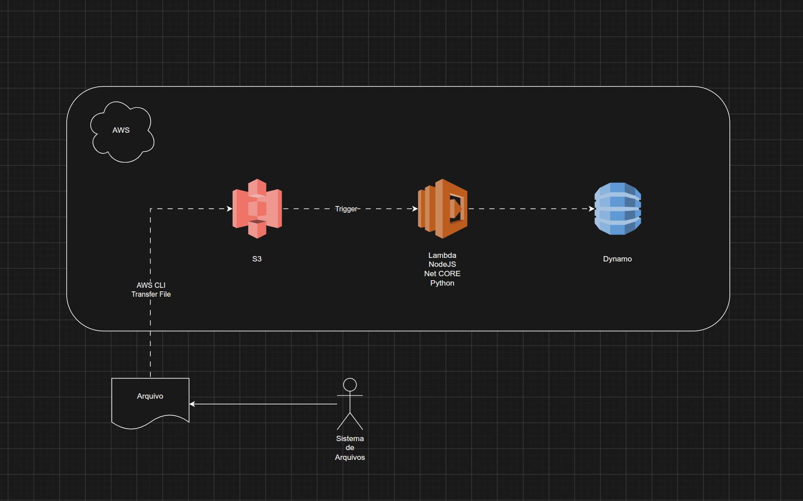

# Gerenciando Instâncias EC2 na AWS

Repositório de documentação do laboratório **Gerenciando Instâncias EC2 na AWS** (DIO). O objetivo é consolidar os conceitos de computação em nuvem da AWS, com foco em **Amazon EC2**, e registrar de forma organizada o que foi aprendido, usando como base dois diagramas de arquitetura:

1. **Arquitetura com EC2** (EC2 + EBS + RDS)
2. **Arquitetura serverless com S3** (S3 + Lambda + DynamoDB)

## Sumário

- [Estrutura do repositório](#estrutura-do-repositório)
- [Visão geral](#visão-geral)
- [Diagrama 1: Arquitetura com EC2](#diagrama-1-arquitetura-com-ec2)
- [Diagrama 2: Arquitetura com S3 e Lambda](#diagrama-2-arquitetura-com-s3-e-lambda)
- [Comparativo entre as duas abordagens](#comparativo-entre-as-duas-abordagens)
- [Gerenciamento de instâncias EC2](#gerenciamento-de-instâncias-ec2)
- [Comandos úteis (AWS CLI)](#comandos-úteis-aws-cli)
- [Boas práticas](#boas-práticas)
- [Aprendizados](#aprendizados)
- [Referências](#referências)

## Estrutura do repositório

```text
.
├── README.md
├── diagrams/
│   └── Desafio.drawio          # Diagramas editáveis (draw.io): páginas "EC2" e "S3"
└── images/
    ├── ec2-architecture.png    # Diagrama 1: EC2 + EBS + RDS
    └── s3-lambda-dynamodb.png  # Diagrama 2: S3 + Lambda + DynamoDB
```

> Os diagramas foram criados no [draw.io](https://app.diagrams.net/). O arquivo `Desafio.drawio` possui duas páginas (**EC2** e **S3**) e pode ser aberto e editado diretamente na ferramenta.

## Visão geral

A AWS oferece diferentes modelos para receber, processar e armazenar arquivos e dados. Este laboratório compara dois deles:

| Modelo | Serviços | Quem gerencia a infraestrutura |
| --- | --- | --- |
| **Servidor virtual (IaaS)** | EC2, EBS, RDS | Você gerencia o SO, patches, escalabilidade e disponibilidade da instância |
| **Serverless (orientado a eventos)** | S3, Lambda, DynamoDB | A AWS gerencia os servidores; você foca no código e na configuração |

## Diagrama 1: Arquitetura com EC2



### Fluxo

1. Um **usuário (Actor)** utiliza seu computador/dispositivo para **enviar um arquivo** à AWS.
2. O arquivo é gravado em um volume **EBS** (identificado no diagrama como **D - EBS**) anexado à instância **EC2**.
3. A instância **EC2** é o servidor de aplicação: ela lê e escreve nos volumes EBS (**D - EBS** e **E - EBS**) e se conecta ao banco de dados relacional **RDS**.
4. O **RDS** armazena os dados estruturados da aplicação.

### Componentes

| Componente | Descrição |
| --- | --- |
| **EC2 (Elastic Compute Cloud)** | Servidor virtual sob demanda. Você escolhe o sistema operacional (AMI), o tipo da instância (CPU/memória/rede) e o armazenamento. |
| **EBS (Elastic Block Store)** | Armazenamento em bloco persistente para EC2, comparável a um disco (HD/SSD) anexado à máquina. Os volumes **D** e **E** representam discos distintos da mesma instância. |
| **RDS (Relational Database Service)** | Banco de dados relacional gerenciado (MySQL, PostgreSQL, MariaDB, Oracle, SQL Server etc.), com backups e patches automatizados. |

### Pontos de atenção

- O volume EBS fica em **uma única Availability Zone** e só pode ser anexado a instâncias da mesma AZ. Para proteção, use **snapshots**.
- A instância EC2 é responsabilidade do usuário: atualização do SO, hardening, monitoramento e escalabilidade (Auto Scaling).
- O RDS evita a necessidade de instalar e administrar o banco manualmente dentro da EC2.

## Diagrama 2: Arquitetura com S3 e Lambda



### Fluxo

1. O **Sistema de Arquivos** gera ou possui um **arquivo** local.
2. O arquivo é transferido para a AWS via **AWS CLI** (*Transfer File*), por exemplo com `aws s3 cp`.
3. O arquivo é armazenado em um bucket do **Amazon S3**.
4. A chegada do objeto no bucket dispara um **Trigger** (notificação de evento do S3).
5. O trigger invoca uma função **AWS Lambda**, que pode ser escrita em **Node.js**, **.NET Core** ou **Python** (entre outras linguagens suportadas).
6. A função processa o arquivo e grava o resultado no **Amazon DynamoDB**.

### Componentes

| Componente | Descrição |
| --- | --- |
| **AWS CLI** | Ferramenta de linha de comando para interagir com os serviços AWS, usada aqui para transferir o arquivo. |
| **Amazon S3** | Armazenamento de objetos altamente durável e escalável. Pode emitir eventos (ex.: `s3:ObjectCreated:*`). |
| **AWS Lambda** | Computação serverless que executa código em resposta a eventos, com cobrança por execução e tempo. |
| **Amazon DynamoDB** | Banco NoSQL gerenciado (chave-valor/documento), de baixa latência e escalável. |

### Pontos de atenção

- A função Lambda precisa de uma **IAM Role** com permissão de leitura no S3 e escrita no DynamoDB (princípio do menor privilégio).
- Evite *loops* de eventos: não grave a saída da Lambda no mesmo bucket e prefixo que dispara o trigger.
- Há limites de tempo de execução e memória da Lambda; para processamentos longos, avalie outras opções.

## Comparativo entre as duas abordagens

| Critério | EC2 + EBS + RDS | S3 + Lambda + DynamoDB |
| --- | --- | --- |
| Gerenciamento | Maior (SO, patches, capacidade) | Menor (serverless) |
| Modelo de cobrança | Por tempo de instância ligada + volumes + banco | Por uso (requisições, execução, armazenamento) |
| Escalabilidade | Via Auto Scaling / Load Balancer | Automática |
| Armazenamento | Bloco (EBS) | Objetos (S3) |
| Banco de dados | Relacional (RDS) | NoSQL (DynamoDB) |
| Controle do ambiente | Total | Limitado ao código e configuração |
| Melhor para | Aplicações tradicionais, cargas contínuas, controle total do SO | Processamento sob demanda, orientado a eventos |

## Gerenciamento de instâncias EC2

### Ciclo de vida

| Estado | Descrição | Cobrança de computação |
| --- | --- | --- |
| `pending` | Instância inicializando | Não |
| `running` | Em execução | Sim |
| `stopping` / `stopped` | Parada (volumes EBS preservados) | Não (volumes EBS continuam cobrados) |
| `shutting-down` / `terminated` | Encerrada permanentemente | Não |

> **Stop** desliga a instância e preserva o EBS. **Terminate** exclui a instância (e, por padrão, o volume raiz).

### Passo a passo para criar uma instância

1. Acessar o console AWS e abrir o serviço **EC2**.
2. Clicar em **Launch instance**.
3. Definir um **nome** e escolher a **AMI** (ex.: Amazon Linux, Ubuntu).
4. Escolher o **tipo de instância** (ex.: `t2.micro` / `t3.micro`, elegíveis ao nível gratuito conforme a conta/região).
5. Criar ou selecionar um **key pair** (par de chaves) para acesso via SSH.
6. Configurar a **rede** e o **Security Group** (liberar apenas as portas necessárias, como 22 para SSH e 80/443 para web).
7. Configurar o **armazenamento** (volume EBS raiz e volumes adicionais, se necessário).
8. Revisar e clicar em **Launch instance**.

### Acesso à instância via SSH

```bash
chmod 400 my-key.pem
ssh -i my-key.pem ec2-user@<PUBLIC_IP_OR_DNS>
```

> Para Ubuntu, o usuário padrão é `ubuntu`; para Amazon Linux, `ec2-user`.

### Anexando um volume EBS adicional (resumo)

1. Criar o volume EBS na **mesma Availability Zone** da instância.
2. Anexar o volume à instância (**Actions → Attach volume**).
3. Dentro da instância, identificar o disco, formatar e montar:

```bash
lsblk
sudo mkfs -t xfs /dev/xvdf
sudo mkdir /data
sudo mount /dev/xvdf /data
```

4. Para montar automaticamente no boot, configurar o arquivo `/etc/fstab`.

### Conexão com o RDS

- Criar a instância RDS na mesma VPC (ou com conectividade adequada).
- No **Security Group do RDS**, permitir a porta do banco (ex.: 3306 para MySQL, 5432 para PostgreSQL) **somente a partir do Security Group da EC2**.
- Conectar a partir da EC2 usando o *endpoint* do RDS.

```bash
mysql -h <RDS_ENDPOINT> -u <USER> -p
```

## Comandos úteis (AWS CLI)

```bash
# Listar instâncias EC2
aws ec2 describe-instances

# Iniciar, parar e encerrar uma instância
aws ec2 start-instances --instance-ids <INSTANCE_ID>
aws ec2 stop-instances --instance-ids <INSTANCE_ID>
aws ec2 terminate-instances --instance-ids <INSTANCE_ID>

# Criar um snapshot de um volume EBS
aws ec2 create-snapshot --volume-id <VOLUME_ID> --description "Backup D-EBS"

# Enviar um arquivo para o S3 (Diagrama 2)
aws s3 cp ./file.txt s3://<BUCKET_NAME>/file.txt

# Listar objetos do bucket
aws s3 ls s3://<BUCKET_NAME>/
```

## Boas práticas

- **Segurança:** libere no Security Group apenas as portas e os IPs necessários; evite abrir a porta 22 para `0.0.0.0/0`.
- **Credenciais:** nunca versione chaves (`.pem`) ou *access keys* no GitHub; use **IAM Roles** em vez de chaves fixas.
- **Menor privilégio:** conceda apenas as permissões IAM necessárias.
- **Backup:** automatize **snapshots** de EBS e backups do RDS.
- **Custos:** pare ou encerre recursos que não estão em uso e configure **alertas de orçamento** (AWS Budgets).
- **Monitoramento:** use o **CloudWatch** para métricas, logs e alarmes.
- **Escalabilidade:** avalie Auto Scaling e Load Balancer para cargas variáveis.
- **Escolha da arquitetura:** use serverless para cargas orientadas a eventos e EC2 quando precisar de controle do ambiente ou cargas contínuas.

## Aprendizados

- A diferença entre **armazenamento em bloco (EBS)** e **armazenamento de objetos (S3)**.
- Por que usar um banco **gerenciado (RDS)** em vez de instalar o banco dentro da EC2.
- Como o **S3 pode acionar uma Lambda** por eventos, criando um fluxo automatizado de processamento sem servidores.
- Quando faz sentido escolher **EC2** (controle total) e quando escolher **serverless** (menos operação e escala automática).
- A importância de **documentar** a arquitetura com diagramas e de compartilhar o conhecimento no GitHub.

## Referências

- [Documentação do Amazon EC2](https://docs.aws.amazon.com/ec2/)
- [Documentação do Amazon EBS](https://docs.aws.amazon.com/ebs/)
- [Documentação do Amazon RDS](https://docs.aws.amazon.com/rds/)
- [Documentação do Amazon S3](https://docs.aws.amazon.com/s3/)
- [Documentação do AWS Lambda](https://docs.aws.amazon.com/lambda/)
- [Documentação do Amazon DynamoDB](https://docs.aws.amazon.com/dynamodb/)
- [AWS CLI Command Reference](https://docs.aws.amazon.com/cli/)
- [draw.io (diagrams.net)](https://app.diagrams.net/)
